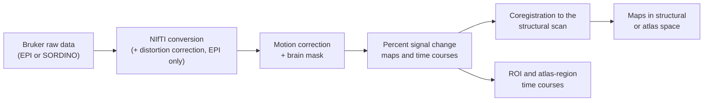

# Molecular fMRI data analysis

Jupyter notebooks and Python scripts to preprocess Bruker (ParaVision) functional MRI data of rodents, compute percent signal change (PSC) maps, extract ROI and atlas-region time courses, and analyse stimulation experiments. Both EPI and SORDINO (zero echo time) data are supported.

Version history: [CHANGELOG.md](CHANGELOG.md).



## Which notebook do I use?

| Experiment | Notebook(s) | Description |
|---|---|---|
| Injection of vasoactive peptides or sensor ligands (EPI or SORDINO) | `mol_fMRI_v5.8.ipynb` | [Injection analysis](#injection-analysis-mol_fmri_v58) below |
| Electrical stimulation, EPI | `mol_fMRI_electric_stim_preprocessing.ipynb`, then `..._analysis.ipynb` and/or `..._poststim_analysis.ipynb` | [docs/electric_stim_analysis.md](docs/electric_stim_analysis.md) |
| Electrical stimulation, SORDINO | `mol_fMRI_sordino_preprocessing.ipynb`, then `mol_fMRI_sordino_analysis.ipynb` and/or `mol_fMRI_sordino_poststim_analysis.ipynb` | [docs/electric_stim_analysis.md](docs/electric_stim_analysis.md) |

Versions: the injection notebook has its own file per version (`mol_fMRI_v5.x.ipynb`); the electrical stimulation notebooks (EPI and SORDINO) share one version number (currently 2.3), printed when a notebook starts and saved in every `session.json`. Both histories are in [CHANGELOG.md](CHANGELOG.md).

The notebooks `mol_fMRI_v5.4` to `v5.6` and `mol_fMRI_elstim_old` are earlier versions that stay in this folder because they use the helper modules next to them. All older, self-contained notebooks are in [archive/](archive). Both are kept for reference only.

## Setup

### Requirements

- Python 3.9 or newer, [Visual Studio Code](https://code.visualstudio.com/) with the *Python* and *Jupyter* extensions
- [FSL](https://fsl.fmrib.ox.ac.uk/) (including `fsleyes`) and [AFNI](https://afni.nimh.nih.gov/), installed separately and available on the `PATH` (nipype only provides Python interfaces to them)
- The Python packages of [requirements.txt](requirements.txt)

### Python environment

With conda (uses [environment.yml](environment.yml)):

```bash
conda env create -f environment.yml
conda activate fmri
```

Or with a plain virtual environment:

```bash
python3 -m venv .venv
source .venv/bin/activate              # Windows: .venv\Scripts\activate
pip install -r requirements.txt
```

`brkraw` has to be version 0.3.11 (newer versions no longer have `brkraw tonii`). If the install above pulls in a wrong version, run:

```bash
pip uninstall brkraw
pip install --no-deps brkraw==0.3.11
```

### Running a notebook in VS Code

1. Open the `.ipynb` file in VS Code.
2. Click the kernel selector (top right) and choose the Python environment from above. To check: run `import sys; print(sys.executable)` in a cell; the output must be that environment's Python.
3. Run cells with `Shift+Enter`, or everything with *Run All*. Restart the kernel from the toolbar.

### Data folder

The notebooks find the shared data folder (the one containing `RawData`, `AnalysedData` and `atlas`) through `fmri_paths.py`, in this order:

1. the environment variable `FMRI_ROOT`
2. the folder saved in `fmri_root.txt` in the repository folder (ignored by git)
3. otherwise a folder selection popup opens and saves the choice in `fmri_root.txt`

So you are asked once per machine. Delete `fmri_root.txt` to choose another folder.

Raw data is read from `RawData/<...>/<session>/<scan number>/` (the Bruker scan folders). Results are written to `AnalysedData/<...>/<subject ID>/`, i.e. next to the session's position in the tree with `RawData` replaced by `AnalysedData`; the subject ID is read from the `subject` file of the session.

### Atlases

The `atlas` folder of the data folder holds the atlases for the registration to atlas space:

- **Rat:** SIGMA in vivo template and anatomical atlas (`atlas/SIGMA_rat_atlas/`).
- **Mouse:** Allen CCFv3 regions (`atlas/Allen_DevCCF_P56/`). The animals are registered to the DevCCF P56 T2-weighted MRI template, which comes with the Allen CCFv3 template and annotation warped into its space; the ROI analysis uses the 316 Allen summary structures, split into left and right. Make the files once with `python tools/build_allen_atlas.py --download` (downloads about 200 MB). Before November 2026 (stimulation notebooks up to v2.2, mol_fMRI v5.8 before its release) the mouse atlas was DSURQE; mouse results made with DSURQE have other region names and are in another space, so do not mix them with new results. An analysis folder that was registered to another atlas is detected and set aside (`previous_atlas_<date>/`) when the analysis is run again.

When you publish results with the mouse atlas, cite: Kronman, F.N. et al. (2024) Developmental mouse brain common coordinate framework. *Nat Commun* 15, 9072 (DevCCF, CC BY 4.0, https://doi.org/10.6084/m9.figshare.25714965), and Wang, Q. et al. (2020) The Allen Mouse Brain Common Coordinate Framework: a 3D reference atlas. *Cell* 181, 936–953.

## Injection analysis (`mol_fMRI_v5.8`)

Standard analysis of an injection experiment (vasoactive peptides or sensor ligands): the signal after the injection is compared with a baseline to give a percent signal change map, plus time courses in hand-drawn or automatic ROIs. One functional scan and one structural scan are processed per run.

### Workflow

1. **Run the function-library cell and the step-selection cell.** Tick the steps to run: Bruker → NIfTI, Distortion correction (EPI only, off by default), Motion correction, Spatial smoothing, Masking. Existing results are never overwritten without asking (`OVERWRITE_POLICY`).
2. **Choose the raw data folder** (the session folder under `RawData`), enter the functional and structural scan numbers and the window size, in **volumes**. The sequence is detected from the scan's `method` file; the *Sequence* dropdown (auto / EPI / SORDINO) overrides it, and you are asked if it cannot be detected. A sordino volume spans more time than an EPI volume (e.g. 2.4 s), so adjust the windows.
3. **Convert and motion-correct** the functional scan (`func.nii.gz`, `mc_func.nii.gz`, `motion.1D`). For sordino the real volume TR is written into the NIfTI header. Distortion correction needs a reverse phase-encoded scan and is only possible for EPI.
4. **Brain masks** (functional analysis folder: `mask_mean_mc_func.nii.gz`, brain without the cannulas, drawn on `middle_vol.nii.gz`, and `mask_mean_mc_func_cannulas.nii.gz`, brain including the cannulas; structural folder: `struct_mask.nii.gz`). Choose in the dropdowns at the top whether they are drawn in fsleyes (default) or made automatically (**still in testing**). The automatic structural mask (`3dSkullStrip -rat` combined with `3dAutomask`) is accurate in tests (overlap with hand-drawn masks 0.97) and can be used after a look at `mask_qc_structural.png`. The automatic functional mask (made from the structural mask) is less accurate (0.85–0.89, down to 0.7) and **must always be checked** in `mask_qc_functional.png`; tested on rat data only. Existing masks are never replaced.
5. **Select the start volumes** of the baseline and the signal window. The notebook smooths the data inside the brain mask and computes the PSC map and PSC time series (`scm_from_sm_*.nii.gz`, `scm_timeseries_from_sm_*.nii.gz`), an exclusion mask for unreliable voxels (brain edge, low baseline, low tSNR) and a despeckled version.
6. **Structural scan:** converted, masked (`struct_mask.nii.gz`), and the functional mean is coregistered to it (rigid body; for EPI with a bounded scaling along the phase-encoding axis). A quality check writes `coregistration_qc.png` and `coregistration_qc.txt`. The PSC maps are saved in structural space (`signal_change_map_coregistered_structural_space.nii.gz` and masked versions).
7. **ROIs and time courses.** Either draw the ROIs in fsleyes, or use the optional automatic ROIs (strongest 3×3 voxel block inside the striatum of the SIGMA rat atlas, per side; the option "Block depth" makes it a 3×3×3 block over three slices, **still in testing**). ROI files are named `roi_{protein/aav}_{direct|aav}_{analyte}_{left|right}.nii.gz`. For each ROI the notebook saves the PSC time course (`PSC_time_series_<roi>.txt`) and a plot.
8. **Optional diagnostics** at the end (`exclusion_diagnostics`) show which exclusion rule removes which voxels, and how much of each ROI is lost. They change no map or mask.

### Where the results are

For a functional scan `<n>` with sequence name `<seq>`:

```
AnalysedData/<...>/<subject ID>/
  <struct scan><seq>/                  struct.nii.gz, struct_mask.nii.gz, cleaned_struct.nii.gz
  <n><seq>/                            func.nii.gz, mc_func.nii.gz, motion.1D, masks, middle_vol.nii.gz
    <timestamp>_<user>/                one folder per run: PSC maps, exclusion masks, coregistration,
                                       ROIs, PSC time courses and plots
```

## Other scripts

| Script | Purpose |
|---|---|
| `scripts/nifti_to_mp4.py` | Movie of the time series of one slice of a 4D NIfTI file |
| `plot_slice_stack.py` | 3D figures of maps in atlas space, built like the 3D viewer of [deConfUSIon](https://github.com/SonerCgu/deConfUSIon): slice stack (slabs of the atlas as tiles side by side), volume rendering and surface rendering, black background, blackbody colours. Mouse maps are shown on the Allen CCFv3 template (found automatically). PNG, interactive viewer you can rotate with the mouse, and rotating MP4. Needs `pyvista` and `imageio-ffmpeg`. Run without arguments for a form; command line e.g. `python plot_slice_stack.py map.nii.gz out.png --view volume --movie out.mp4`; use `--projection max` for small or sparse effects |
| `tools/build_allen_atlas.py` | Builds the mouse atlas files once (Allen regions on the DevCCF MRI template, see *Atlases* above) |
| `scripts/roi_atlas_analysis.py` | Time courses of every region of a multi-label atlas |
| `mol_fMRI_distortion_correction_rp.py` | EPI distortion correction (FSL topup), used by the notebooks |

Group-level analysis scripts and FC-QC scripts (in [scripts/](scripts)) are being cleaned up and are not documented yet.

## Contributing

- **Notebooks are committed without outputs** (outputs make the repository large and the diffs unreadable). Once per clone, run `nbstripout --install --attributes .gitattributes`; git then strips the outputs on commit, and your local notebook keeps them. To strip notebooks that are already tracked, run `git add --renormalize .` once and commit.
- **Checks:** `python tools/check_repo.py` checks the syntax of all Python files and notebook cells and that no notebook has outputs. GitHub Actions runs it on every push.
- **New version of the pipeline:** copy the newest `mol_fMRI_v5.x.ipynb` to a new file, change it, and add a section at the top of [CHANGELOG.md](CHANGELOG.md).
- To cite this repository, use *Cite this repository* on the GitHub page ([CITATION.cff](CITATION.cff)).
